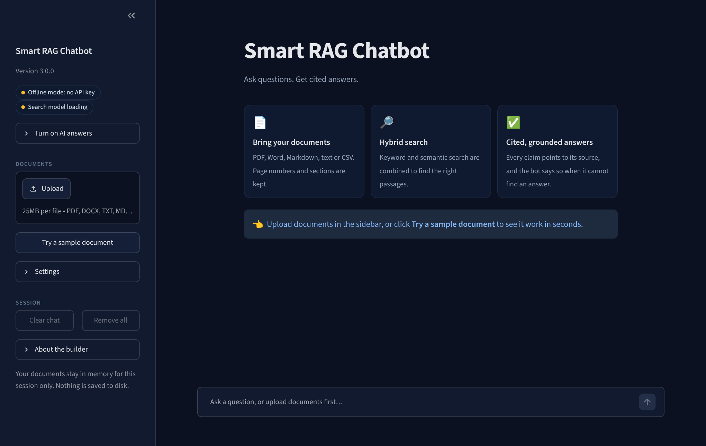

<div align="center">

# 🤖 Smart RAG Chatbot

**Ask questions about your own documents and get answers you can check.**
Every claim cites its source: file, page or section, and the exact passage.

<br/>

[](https://smart-rag-chatbot-izxizdewwebpsrmhhufyxe.streamlit.app/)

<br/>

[](https://www.python.org/)
[](https://streamlit.io/)
[](https://groq.com/)
[](https://github.com/facebookresearch/faiss)
[](https://github.com/Junaid-Ahmed-Rupok/smart-rag-chatbot/actions/workflows/tests.yml)
[](LICENSE)

<br/>



</div>

---

## ✨ What makes it different

Most RAG demos paste your files into a vector store and hope. This one is built to be **checked, not trusted**.

| | |
|---|---|
| 📌 **Real citations** | Answers carry `[1]`, `[2]` markers. Open a source to read the exact passage, with the file name and **page number** (PDF) or **section** (Word, Markdown), and the matching words highlighted. |
| 🧱 **Grounded or silent** | If your documents do not cover a question, the bot says so instead of guessing. A relevance check blocks answers built from passages that do not match. A switch allows general answers when you want them. |
| 🔎 **Hybrid search** | Semantic search (FAISS) and keyword search (BM25) run side by side and are merged with reciprocal rank fusion, so exact names and numbers are found as well as paraphrases. Works for Bengali text too. |
| ⚡ **Streaming answers** | Text appears as it is written, with the model, response time and number of passages shown under each answer. |
| 🧠 **Follow-up aware** | Questions like *"why is it needed?"* are rewritten into standalone questions before searching. |
| 📄 **Many formats** | PDF (page-aware), DOCX (headings and tables), Markdown, TXT, CSV. Clear messages for scanned PDFs, password-protected files and damaged files. |
| 🗂️ **Document control** | Add and remove single documents, duplicates are detected, and a *Try a sample document* button lets visitors test it in one click. |
| 🔒 **Private by design** | Documents live in memory for the session only. Nothing is written to disk, and there is no stored index to leak. Chat export is a download, not a database. |
| 🛟 **Never a dead end** | No API key? It runs in offline mode and shows the best matching passages. Rate limited? It falls back to a lighter model. Search model unavailable? It uses keyword search and says so. |
| 😴 **Never sleeps** | A scheduled job opens the app in a real browser every four hours (see [Staying awake](#-staying-awake)). |

---

## 🏗️ How it works

```
Upload (PDF · DOCX · MD · TXT · CSV)
   │   page numbers and sections are kept
   ▼
Chunk      overlapping passages (LangChain text splitter)
   ▼
Index      MiniLM embeddings → FAISS      +      BM25 keyword index
   ▼
Question ─► rewrite follow-ups ─► hybrid search ─► reciprocal rank fusion ─► relevance check
   ▼
Generate   numbered passages + strict instructions → Groq (streamed)
   ▼
Answer with [n] citations ─► source cards (file · page · highlighted passage)
```

The embedding model is loaded **once per server** in the background and shared by every visitor, so memory stays low and the first question is not slowed by a model download.

---

## 🚀 Run it locally

```bash
git clone https://github.com/Junaid-Ahmed-Rupok/smart-rag-chatbot.git
cd smart-rag-chatbot
python -m venv .venv && source .venv/bin/activate      # Windows: .venv\Scripts\activate
pip install -r requirements.txt
cp .env.example .env                                   # then paste your free Groq key
streamlit run Main.py
```

Get a free key at [console.groq.com/keys](https://console.groq.com/keys). Without one the app still runs in offline mode.

**Fully offline:** install [Ollama](https://ollama.com), run `ollama pull mistral`, and set `LLM_PROVIDER=ollama` in `.env`.

---

## ☁️ Deploy on Streamlit Community Cloud (free)

1. Fork or push this repository to GitHub.
2. On [share.streamlit.io](https://share.streamlit.io) choose **New app**, branch `main`, main file **`Main.py`**.
3. Under **Advanced settings → Secrets** add:

```toml
GROQ_API_KEY = "gsk_your_key_here"
```

---

## 😴 Staying awake

Streamlit Community Cloud puts an app to sleep after a period with no visitors. `.github/workflows/keepalive.yml` runs every four hours and opens the app in a real headless browser, clicks the *wake up* button if the app had slept, and then checks that the page actually rendered. If it did not, the run fails and GitHub emails you.

- The app URL is in the workflow; to point it elsewhere add a repository secret named `APP_URL`.
- GitHub disables scheduled workflows after 60 days with no repository activity. Any push, or a manual *Run workflow*, switches them back on.

---

## 🔧 Configuration

Settings come from environment variables, `.env`, or Streamlit Secrets. All are optional except a Groq key for AI answers.

| Variable | Default | Description |
|---|---|---|
| `GROQ_API_KEY` | none | Free key. Without it the app runs in offline mode |
| `LLM_PROVIDER` | auto | `groq`, `ollama` or `offline` |
| `GROQ_MODEL` | `llama-3.3-70b-versatile` | Default model. The list in the sidebar is fetched live from Groq |
| `OLLAMA_HOST` / `OLLAMA_MODEL` | `http://localhost:11434` / `mistral` | Local model settings |
| `EMBEDDING_MODEL` | `sentence-transformers/all-MiniLM-L6-v2` | Use `paraphrase-multilingual-MiniLM-L12-v2` for Bengali and other languages |
| `CHUNK_SIZE` / `CHUNK_OVERLAP` | `900` / `150` | Characters per passage and overlap |
| `RETRIEVAL_K` | `5` | Passages per answer (adjustable in the sidebar) |
| `MEMORY_TURNS` | `6` | Past turns sent to the model |
| `MAX_FILE_MB` / `MAX_FILES` / `MAX_CHUNKS` | `25` / `10` / `6000` | Upload and index limits per session |
| `TEMPERATURE` / `MAX_TOKENS` | `0.2` / `900` | Generation settings |

---

## 🗂️ Project layout

```
Main.py                 Entry point (streamlit run Main.py)
smartrag/
  settings.py           Configuration with safe fallbacks
  documents.py          File readers: page- and section-aware, friendly errors
  chunking.py           Overlapping chunks that remember their location
  bm25.py               Keyword ranking (English and Bengali)
  embeddings.py         One shared, background-loaded embedding model
  index.py              Knowledge base: FAISS + BM25 + rank fusion + relevance check
  prompts.py            Prompt construction
  llm.py                Groq (streaming, model fallback), Ollama, offline
  engine.py             One question-and-answer turn, citations, refusal logic
  export.py             Chat transcript download
  about.py              Creator information, shown only when asked
  ui/                   Streamlit interface: sidebar, chat, styles, state
samples/                Sample document for one-click demos
tests/                  pytest suite (loaders, search, engine, model errors, full UI)
keepalive.py            Wake-up and health check used by the scheduled workflow
```

---

## ✅ Tests

```bash
pip install -r requirements-dev.txt
python -m pytest -q
```

The suite runs the real app through Streamlit's test runner with a stand-in language model and embedding model, so it needs no API key and no network. It covers file readers (including scanned, damaged and password-protected PDFs), chunking, keyword and hybrid search, removing and replacing documents, refusal when nothing matches, citation handling, rate-limit fallback, offline mode, and the full chat flow. It runs on every push through GitHub Actions.

---

## ⚠️ Limits

- **Scanned PDFs** (pictures of text) need OCR, which is not included yet. The app tells you so.
- **Language:** the default search model is English. Keyword search still finds Bengali text, and a multilingual model can be set with `EMBEDDING_MODEL`.
- **Free tier:** Groq's free tier has rate limits. The app falls back to a lighter model and shows a friendly message if both are busy.
- **Relevance check** is a heuristic. It is tuned to decline clearly unrelated questions, not to replace reading the cited source.
- Tables and charts inside PDFs may be read imperfectly. Answers are written by a language model, so check important facts against the cited passage.

---

## 🛣️ Roadmap

- [ ] OCR for scanned PDFs
- [ ] Multilingual embeddings as the default
- [ ] Evaluation set for retrieval quality (hit rate, citation accuracy)
- [ ] Optional per-user saved libraries (off by default)

Suggestions and pull requests are welcome.

---

## 👨‍💻 About the Developer

<div align="center">


### Sarder Junaid Ahmed
**Data Scientist & Machine Learning Engineer**

*Transforming complex data into strategic decisions through rigorous statistical modeling and production-ready machine learning systems.*

[](https://github.com/Junaid-Ahmed-Rupok)
[](https://www.linkedin.com/in/sarder-junaid-ahmed-059b68240/)
[](https://junaid-ahmed-rupok.github.io/__portfolio__Yes/)
[](mailto:junaidahmedrupok@gmail.com)
</div>

**Specializations:** Statistical ML · Causal Inference · Trustworthy AI · Fairness-Aware ML · RAG Systems

**Selected Research:**
- 📄 **Ahmed, S.J.** et al. (2026). *Machine Learning for Crime Classification: A Fairness-Aware Approach to Class Imbalance.* Journal of Machine Learning and Applications, 2(1), 9–17. [DOI: 10.61577/jmla.2026.100002](https://doi.org/10.61577/jmla.2026.100002)
- 📄 **Ahmed, S.J.** et al. (2026). *Machine Learning for Crime Classification: A Fairness-Aware Approach to Class Imbalance.* IEEE SPICSCON 2026, BAUET, Bangladesh (Aug 13–14, 2026). **Accepted for Presentation** — IEEE Xplore.
- 📄 **Ahmed, S.J.** et al. (2026). *CF-EGAT: A Causal Fairness-Aware Equity Graph Attention Network for Country-Level Environmental Livability Classification.* SPECTRA 2026. 🏆 **1st Best Paper Award**
- 📄 **Ahmed, S.J.** (2025). *Multi-Dimensional Statistical Similarity for Governance Classification: Beyond Arbitrary Thresholds.* APMEE 2025. 🏆 **Best Research Paper Award**
- 📄 **Ahmed, S.J.** (2026). *DeepEnMap: Ordinal-Aware Multi-Modal Deep Learning for Energy Poverty Risk Mapping.* IEMIS 2026, University of British Columbia, Vancouver, Canada (Aug 10–12, 2026). **Accepted for Presentation** — Springer LNNS Series (Scopus, EI-Compendex, DBLP, ISI Proceedings).
- 📄 **Ahmed, S.J.** (2026). *Density-Decoupled, Mask-Ablated Segmentation-Guided Diffusion for Controllable Mammography Synthesis: A Preliminary Study.* IEMIS 2026, University of British Columbia, Vancouver, Canada (Aug 10–12, 2026). **Accepted for Presentation** — Springer LNNS Series (Scopus, EI-Compendex, DBLP, ISI Proceedings).
- 📄 **Ahmed, S.J.**, Islam Nahian, M.T., & Kwoshik, M.H.R. (2026). *Environmental Livability Assessment via Adaptive Bootstrap-Retrained SHAP and Statistically-Constrained Pareto Counterfactuals: A Cross-National Analysis.* IEEE SPICSCON 2026, BAUET, Bangladesh (Aug 13–14, 2026). **Accepted for Presentation** — IEEE Xplore.
- 📄 **Ahmed, S.J.** (2026). *DemocracyGuard: Testing a Divergence-Index Reconciliation of Subjective and Objective Democracy Indicators for Forecasting Adverse Regime Transitions.* **Under Review**, Transactions on Machine Learning Research (TMLR) — Q1, Top-Tier Journal.
- 📄 **Ahmed, S.J.** (2026). *FAI: Feature-Wise Adaptive Imputation via Downstream-Aware Method Selection.* **Under Review**, ICISET 2026 (IEEE Xplore).

**Other Deployed Projects:**
- 🔬 [ReproHub](https://reproapp-8jb7vbhnqyltxq23bsr8xn.streamlit.app/) — Automated research reproducibility platform with composite scoring across 11 statistical tests
- 📊 [StatsPro](https://statistical-analysis-app-7axetqtx75ncuu7fr8irxj.streamlit.app/) — AI-powered statistical analysis platform with automated CSV-to-report workflows

**Honors:**
🏆 1st Best Paper — SPECTRA 2026 &nbsp;·&nbsp;
🏆 Best Research Paper — APMEE 2025 &nbsp;·&nbsp;
🎖️ Esteemed Alumni Award — YLRL RUET 2024 &nbsp;·&nbsp;
⭐ Perfect GPA 5.00/5.00 — SSC & HSC &nbsp;·&nbsp;
🎓 National Merit Scholarship — 2009 & 2013

---

## 📄 License

MIT — see [LICENSE](LICENSE).

<div align="center">

Built with [Streamlit](https://streamlit.io) · [Groq](https://groq.com) · [FAISS](https://github.com/facebookresearch/faiss) · [sentence-transformers](https://www.sbert.net) · [LangChain text splitters](https://python.langchain.com)

</div>
